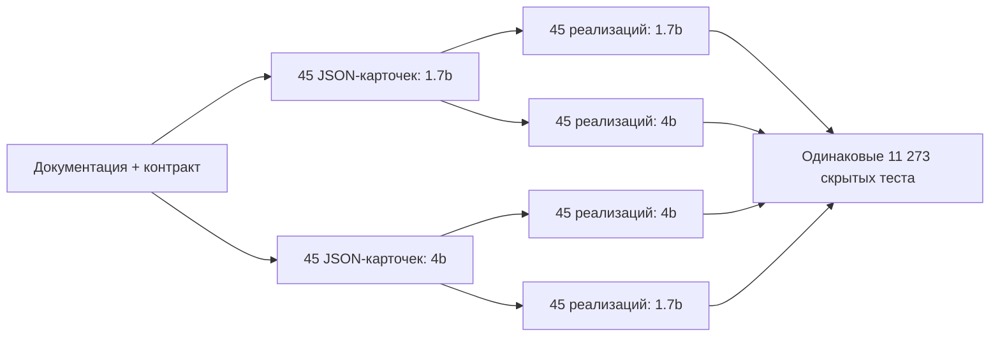

# Qwen: восстановление 45 функций по карточкам

Главный документ с результатами — [REPORT.md](REPORT.md). Подробный протокол — [METHODOLOGY.md](METHODOLOGY.md), примеры ошибок карточек — [CARD_REVIEW.md](CARD_REVIEW.md). Данные сводки — [summary.json](summary.json), проверка целостности — [audit.json](audit.json).

Полные наборы карточек также собраны в [cards_qwen3_1_7b.json](cards_qwen3_1_7b.json) и [cards_qwen3_4b.json](cards_qwen3_4b.json). Архив [qwen_method_benchmark_results.zip](qwen_method_benchmark_results.zip) включает исходные данные и результаты без весов моделей и больших каталогов зависимостей; `ARTIFACT_SHA256.json` содержит хеши его файлов.



Проверяются четыре комбинации автора карточки и восстановителя: `qwen3:1.7b → qwen3:1.7b`, `qwen3:4b → qwen3:4b`, `qwen3:1.7b → qwen3:4b`, `qwen3:4b → qwen3:1.7b`.

## Что находится в проекте

| Путь | Содержимое |
|---|---|
| `frozen/manifest.json` | 45 функций, версии библиотек, число тестов и SHA-256 |
| `frozen/<library>.<function>.json` | Исходный docstring, контракт, тестовые входы и эталоны |
| `frozen/config.json` | Обе системные инструкции, JSON Schema и параметры генерации |
| `frozen/environment.json` | Модели, digest, квантование, Python, пакеты, Ollama и оборудование |
| `frozen/runtime.json` | Локальный CUDA-компонент и его версии |
| `frozen/protocol_code_hashes.json` | Хеши протокола и кода до основного прогона |
| `cards/small`, `cards/large` | 90 JSON-карточек в удобном для чтения виде |
| `implementations/<condition>/` | Неизменённый Python-код каждого восстановления |
| `runs/cards`, `runs/code` | Полные запросы и ответы Ollama, время и токены |
| `results/<condition>/` | Результаты каждого теста, ожидаемые и полученные ответы |
| `failure_examples.json` | Первый контрпример каждой неуспешной реализации |
| `pilot_cpu/` | Технический CPU-пилот, исключённый из основного сравнения |
| `logs/` | Журналы генерации и сервера |
| `.venv/` | Изолированное Python-окружение |
| `.runtime/` | Локальная Ollama с CUDA; системная установка не заменялась |

`small` соответствует установленному тегу `qwen3:1.7b`, `large` — `qwen3:4b`. При этом GGUF-метаданные small сообщают 2 031 739 904 параметра; обозначения сохранены по исходным тегам.

## Просмотр и повторная проверка

Из каталога `/home/alikhan/AISpace/qwen_method_benchmark`:

```sh
.venv/bin/python audit.py
.venv/bin/python report.py
```

Аудит проверяет хеши зафиксированных файлов, неизменность выданного моделями кода, соответствие входов и эталонов, учёт всех результатов и то, что восстановителю передавалась только соответствующая карточка. Он не обращается к моделям.

## Возобновление прерванного прогона

Если сервер Ollama не запущен, в отдельном терминале:

```sh
OLLAMA_HOST=127.0.0.1:11434 OLLAMA_MAX_LOADED_MODELS=1 .runtime/usr/bin/ollama serve
```

Затем:

```sh
.venv/bin/python experiment.py run
.venv/bin/python report.py
.venv/bin/python audit.py
```

Уже завершённые ответы читаются из сохранённых файлов. Запрос повторно не выполняется, если он уже записан. Протокол, тесты, параметры и digest моделей проверяются; скрытые исправления ответов не производятся. Не запускайте два процесса `experiment.py run` одновременно в одном каталоге.

## Независимый новый прогон

Скопируйте исходные `.py`, `requirements.txt`, `METHODOLOGY.md` и каталог `frozen/` в новый каталог; не копируйте `runs/`, `cards/`, `implementations/`, `results/` и сводные результаты. Создайте отдельное окружение и установите зафиксированные зависимости:

```sh
python -m venv .venv
.venv/bin/python -m pip install -r requirements.txt
.venv/bin/python dataset.py
.venv/bin/python experiment.py run
.venv/bin/python report.py
.venv/bin/python audit.py
```

Требуются Linux, `bubblewrap`, Ollama и модели с совпадающими digest. Перенос на другую систему может потребовать изменения путей `bwrap`; это будет отдельная версия протокола. Точная повторяемость генерации между разными GPU и версиями runtime не гарантируется. Для нового протокола или иных моделей создавайте новый каталог, сохраняя исходный эксперимент.

## Примечание о точности

Успешное прохождение всех тестов означает эмпирическую корректность на зафиксированной выборке. Это не формальное доказательство, не проверка всего API библиотек и не оценка всех возможных Python-методов. В основном прогоне один ответ на задачу, без thinking и без исправления после тестов.
